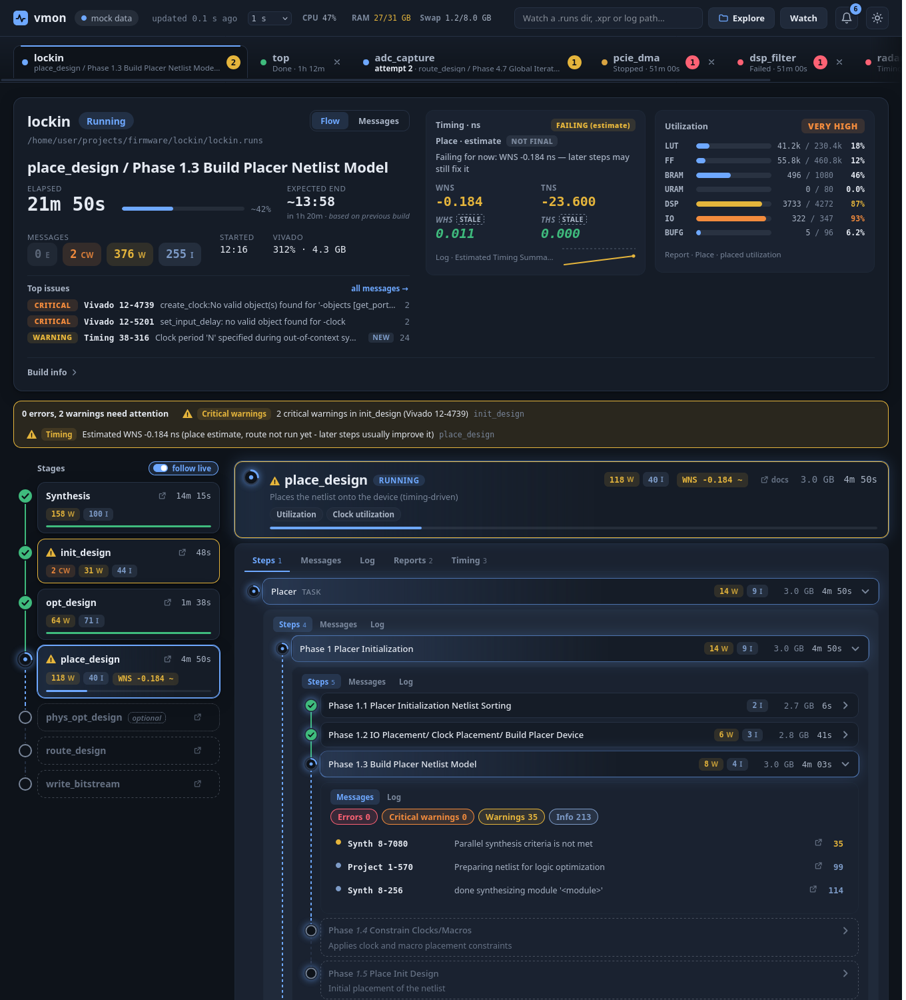
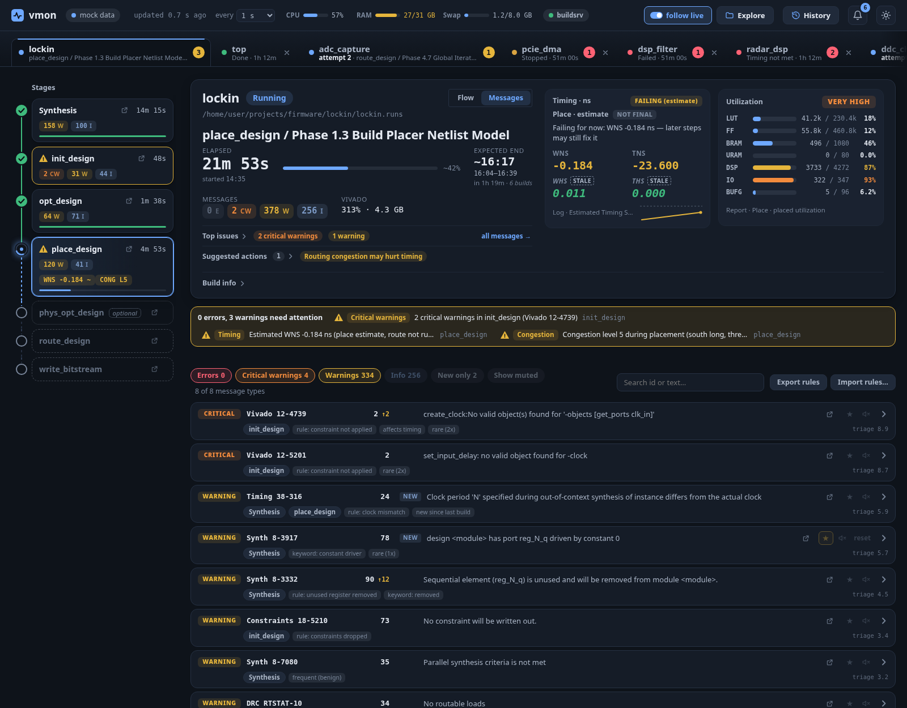
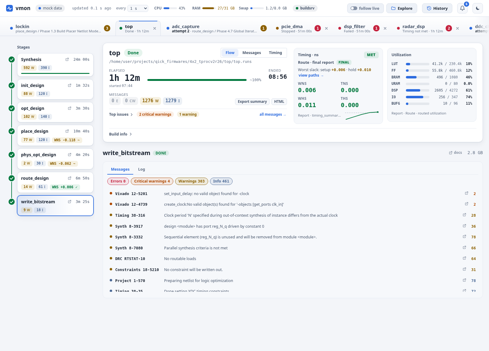
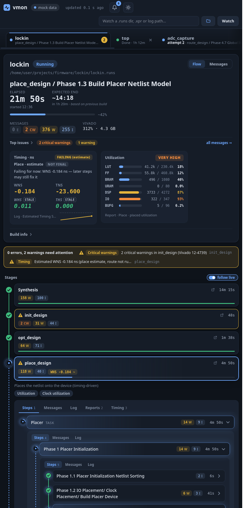
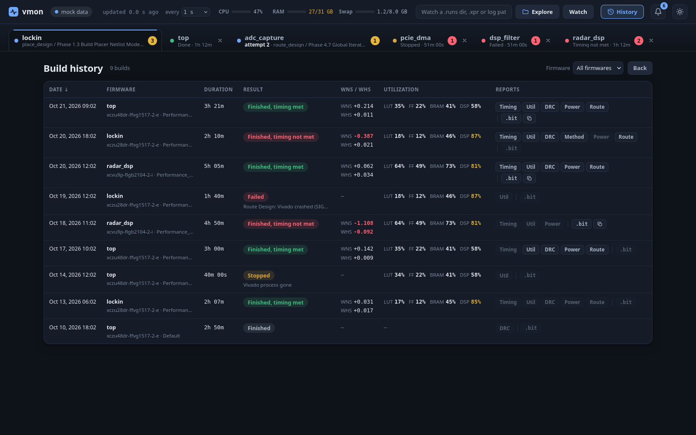
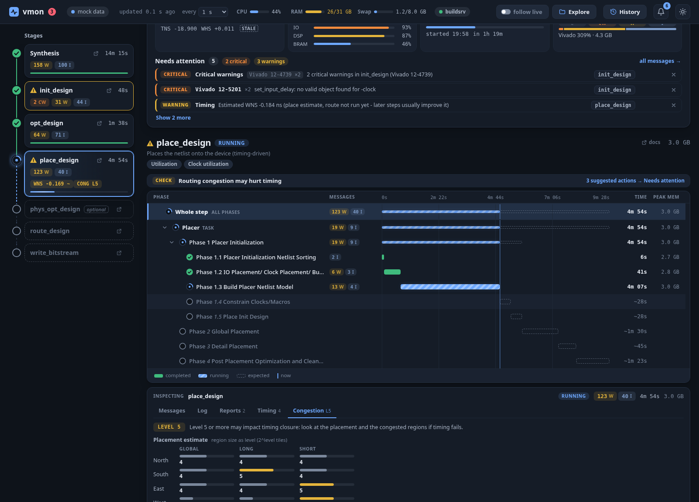
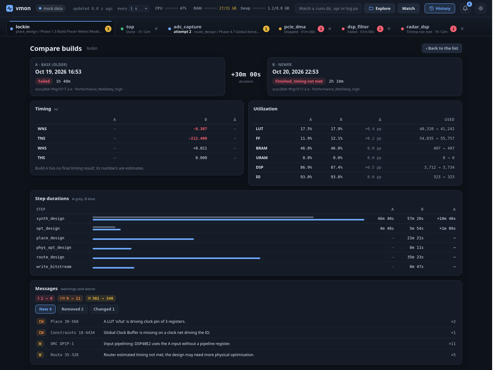
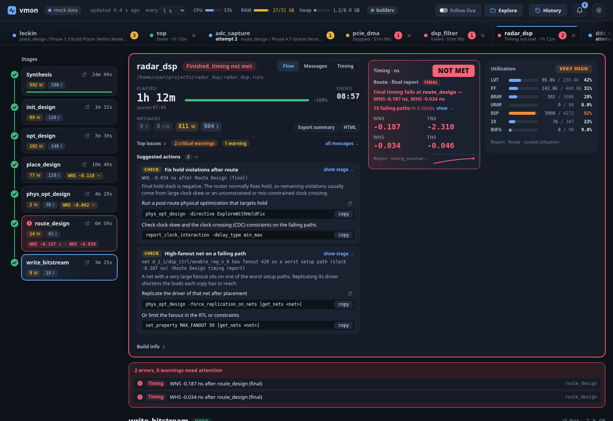

# vmon

[](https://github.com/rodolfocarobene/vivado_monitor/actions/workflows/ci.yml)

Live web monitor for Xilinx Vivado builds: see which step and phase is running, what is still to come, timing, utilization and the warnings that matter, without opening a log file.



## Features

- **Auto-discovery** of running Vivado processes; one tab per firmware, finished runs stay visible.
- **Stage rail + drill-down**: synth, opt, place, phys_opt, route, bitstream stay pinned in a left rail, with a *follow live* switch in the top bar; the selected stage drills down on the right (on narrow windows the list becomes one tree, with the stage opening in place). Upcoming steps and phases come from a per-version phase catalog, with predicted phase numbers.
- **Timing you can trust**: intermediate and estimated values are shown as "not final"; red only when the final result fails. Missing hold metrics are carried forward and marked stale.
- **Utilization card**, parsing of intermediate reports (timing, DRC, power, route status, ...).
- **Worst timing paths** (setup/hold, logic vs route; expand one to see it as a chain of blocks: launch register, each cell and net with its delay and fanout, capture register), **per-clock history** across stages and builds with regressions highlighted.
- **Router convergence chart** (overlaps and slack per iteration, live) and an alert when the router stalls or diverges.
- **Alerts** (dismissable one by one; the banner keeps the counts) with browser notifications, and an in-app event log. Optional server-side notifications (`notify-send`, ntfy, Slack, Matrix, JSON webhook) for crashes and timing failures, with no browser open; off by default, set up in `[notify]` (see [docs/configuration.md](docs/configuration.md)).
- **Suggested actions**: rule-based hints from `[[hints]]` in `flows.toml` (hold violated after route, route- or logic-dominated setup paths, high fanout, congestion, router stalled, out of memory, lost license, latches, ...), each with the evidence that fired it and commands you can copy; add your own or disable built-ins in your config (see [docs/configuration.md](docs/configuration.md#recommended-actions)).
- **Message triage**: severity, rules, keywords, rarity and "new since last build" scoring; pin or mute any message id.
- **Share message rules**: export your ★/mute rules to a file and import a teammate's (or your other machine's) with a preview of what changes first (merge or replace).
- **ETA with a confidence band**: per-step and per-phase durations learned from the last 20 builds of the same firmware (medians, p10-p90 range); steps never seen are sized from the catalog.
- **Congestion summary** for place and route: placer and router congestion levels per direction, final max congestion, router overlaps per iteration; a chip and an alert from level 5.
- **Build history page**: every finished build with date, duration, outcome, final WNS/WHS, utilization, and links to its reports and `.bit` (only while the files still belong to that build). Each row shows the project path; a *Finished only* switch hides failed and stopped builds. Click a build to open its project in the standard view (it is loaded again if its tab was closed). Tick any two builds to compare them, even of different firmwares (for example a copied project folder).
- **Compare two builds** of a firmware (pick two, or "vs previous"): timing and utilization deltas, step durations, new/removed/changed warnings. A comparison opens as its own tab after the firmware tabs (close it with its ×, or Delete); it stays open while you switch tabs and after a reload.
- **Compare a build in progress**: unfinished firmwares appear as pinned *Live* rows in the history, and the firmware header has a *Compare* button. The live side is the current state (provisional, refreshed every 5 s while its tab is shown) and is never stored in the history.
- **Export a build summary** as Markdown or a self-contained HTML page (timing, utilization, top warnings, attempts, reports), or copy it to the clipboard.
- **Remote builds**: watch a build server through an SSH tunnel, or aggregate several machines in one UI; each remote firmware gets a host badge, and an unreachable host leaves its tabs visible but marked stale.
- **Build info**: part, board, strategies, directives; links to AMD documentation.
- **System CPU / RAM / swap** meters, sticky summary, folder explorer to add runs.
- **Keyboard**: `1`-`9` firmware tabs, `f`/`m`/`t` views, `j`/`k` stages, `n` next alert, `c` collapse all, `h` build history, `?` help; arrow keys on the tab strip.
- No AI: pure log parsing. Read-only. Python standard library only.

| Messages triage | Light theme, finished build | Narrow window |
|---|---|---|
|  |  |  |

| Build history | Congestion (route) |
|---|---|
|  |  |





## Requirements

- Linux, or Windows (experimental, see below)
- Python 3.11 or newer
- Vivado project-mode or non-project logs

> [!IMPORTANT]
> **Testing is limited.** vmon has been used and checked on one Linux machine, with Vivado 2023.2 on UltraScale+ RFSoC, plus the automated tests and the mock data in this repository. Other Vivado versions, device families and flows have not been tested and may need catalog entries (see [docs/catalog.md](docs/catalog.md)).
>
> **Windows support has not been tested with a real Vivado build.** It runs only in CI (unit tests and a smoke test on GitHub's `windows-latest`, without Vivado). Process discovery, log and path handling, the folder explorer and desktop notifications on Windows are implemented but unverified in practice. Reports from Windows users are welcome.

> [!NOTE]
> **About this code.** All the code in this repository was written by Claude (Anthropic's AI model). A human checked it only functionally, by using it and reviewing its behaviour, not by reviewing the code line by line.

## Install

```sh
git clone <repo-url> vivado-monitor
cd vivado-monitor
python -m venv .venv
.venv/bin/pip install -e .      # provides the `vmon` command
```

On Windows (PowerShell):

```powershell
py -m venv .venv
.venv\Scripts\pip install -e .
.venv\Scripts\vmon            # or: py -m vmon
```

Or run without installing: `python -m vmon`.

## Usage

```sh
vmon                          # watch all running Vivado builds, open the browser
vmon path/to/proj.runs        # also watch a .runs dir, .xpr or log file
vmon --port 9000 --no-browser
vmon status                   # one-shot text summary, no browser (quick check over SSH)
vmon --tui                    # live full-screen terminal view
```

| Option | Default | Meaning |
|---|---|---|
| `paths` | | `.runs` dir, `.xpr`, run dir or log file to watch |
| `--port` | 8765 | Port to serve on; if busy, the next 10 ports are tried |
| `--host` | 127.0.0.1 | Bind address |
| `--interval` | 1.0 | Poll interval in seconds (also changeable in the UI) |
| `--no-browser` | | Do not open the browser |
| `--config FILE` | | Extra `flows.toml` merged over the defaults |
| `--remote NAME=URL` | | Aggregate another vmon, e.g. `buildsrv=http://127.0.0.1:9001` (repeatable; also `[remote]` in `flows.toml`) |
| `--tui` | | Full-screen terminal view instead of the web UI (curses; on Windows a refreshing text view) |
| `--ssh USER@HOST[:PORT]` | | Start `ssh -N -L` to the vmon on that host (default remote port 8765) and aggregate it; the tunnel ends with vmon |

If a vmon is already running on the port, the new command hands it your paths and opens the browser on it instead of starting a second server.

### Terminal mode

`vmon status [paths...]` prints one line per firmware: name (`name@host` for remotes), outcome (the web UI's words, e.g. `Finished, timing not met`), current step or failure reason, progress (`~42%` is an estimate), elapsed, expected end with its range, WNS/WHS (a leading `~` marks a non-final estimate), message counts E/CW/W and the alert count. Firmwares with alerts or hints get up to three indented lines below. Colors (green met/done, red only final failures, amber warnings, estimates and stale remotes, blue running) are used only on a terminal, never with `--no-color` or `NO_COLOR`.

```sh
vmon status                                # whatever is running or remembered
vmon status path/to/proj.runs --json       # for scripts
vmon status --watch 5                      # refresh every 5 s, Ctrl-C to stop
ssh user@server vmon status                # over SSH, nothing to forward
```

Data source: if a vmon answers on `--host`/`--port` it is used (with its remotes; `paths` then only filter its firmwares). Otherwise vmon computes one snapshot locally from the running Vivado processes, the remembered paths and the given paths, without a server or browser. Local mode never updates the remembered (recent) paths; its tick writes only the usual cache files (message baselines, step durations, history), and `[remote]` entries of `flows.toml` are not polled.

`vmon status` is the subcommand only when it is the first argument and no file or directory called `status` exists in the current directory (then it is a path, as before).

| Exit code | Meaning |
|---|---|
| 0 | nothing failed (running, done, stopped, queued) |
| 1 | a firmware failed, or finished with final timing not met |
| 2 | usage or configuration error |
| 3 | nothing to show: no vmon reachable and no firmware found or watched |

`vmon --tui [paths...]` is the same data in a live screen: firmware list on top, the selected firmware's stages (status markers, durations, running phase, WNS chip) and its alerts and hints below. Keys: `↑`/`↓` or `j`/`k` move, `Enter`/`→` expand (alerts under a firmware, children of a stage), `←` collapse, `Tab` switches between the two panes, `r` refreshes, `h` help, `q` quits. It connects to a running vmon or starts its own monitor in a background thread; the terminal is restored on exit. It needs `curses`, which Windows lacks: there (or without a TTY) `--tui` shows the refreshing text view of `vmon status --watch` instead.

`vmon status` takes `paths`, `--port`, `--host` and `--config` like `vmon`, plus:

| Option | Meaning |
|---|---|
| `--json` | Print JSON (firmware subset, remotes, exit code) instead of the table |
| `--watch SECONDS` | Reprint every SECONDS until Ctrl-C (clears the screen on a terminal) |
| `--no-color` | No ANSI colors (also `NO_COLOR`, or output that is not a terminal) |

### Watching a build server

Run a normal vmon on the server (it binds to `127.0.0.1` there), forward its port, and aggregate it locally:

```sh
ssh -N -L 9001:127.0.0.1:8765 user@server &          # or let vmon do it: vmon --ssh user@server
vmon --remote buildsrv=http://127.0.0.1:9001
```

Remote firmwares appear as tabs with a host badge; the top bar shows one dot per remote (hover for the address and last update). Messages, logs, reports, timing paths, history, comparisons, summaries and downloads are fetched from the server on demand through your local vmon, which only ever talks to the hosts you configured. `Explore` still acts on this machine. See [docs/configuration.md](docs/configuration.md#remote-vmon-instances).

Demo without Vivado: serve `vmon/static/` with any static server and open `index.html?mock=1`, for example `python -m http.server 8798 --bind 127.0.0.1 --directory vmon/static`.

## Configuration and extending

All Vivado-specific knowledge is data, not code.

- `vmon/flows.toml`: line rules, timing patterns, steps, report parsers, alert thresholds, docs links, message triage rules. Override with `~/.config/vmon/flows.toml` (Windows: `%APPDATA%\vmon\flows.toml`).
- `vmon/catalog/vivado_<ver>.toml`: steps, phases and tasks per Vivado version. Override or add under `~/.config/vmon/catalog/` (Windows: `%APPDATA%\vmon\catalog\`).
- `~/.config/vmon/message_rules.json` (Windows: `%APPDATA%\vmon\`): your message priorities (written by the UI).
- `~/.cache/vmon/` (Windows: `%LOCALAPPDATA%\vmon\`): recent paths, previous-build baselines, step durations, build history.

See [docs/configuration.md](docs/configuration.md), [docs/catalog.md](docs/catalog.md) and [docs/architecture.md](docs/architecture.md).

## Safety

vmon is read-only on your build directories and never signals or kills processes. It binds to `127.0.0.1` by default. With remotes it makes HTTP requests to the configured URLs only (no redirects, no proxies). It writes only to its cache and message-rules file (`~/.cache/vmon/` and `~/.config/vmon/message_rules.json`; on Windows `%LOCALAPPDATA%\vmon\` and `%APPDATA%\vmon\message_rules.json`). On Windows it reads other processes' command line and working directory with query/read access only.

## Development

```sh
.venv/bin/pip install -r requirements-dev.txt
.venv/bin/python -m pytest -q
.venv/bin/python tools/check_docs.py   # docs cover every API route, config section and CLI option
```

Browser tests (`tests/e2e/`, marked `e2e`) drive the UI in headless Chromium through Playwright, which is a development-only dependency (pinned in `requirements-dev.txt`, currently 1.64.0; vmon itself still has no runtime dependencies). Install the browser once, then run them:

```sh
.venv/bin/python -m playwright install chromium
.venv/bin/python -m pytest -m e2e -q
```

Without playwright or a browser they are skipped, so a plain `python -m pytest` works everywhere. Set `VMON_E2E_BROWSER=firefox` to use Firefox instead (`playwright install firefox`), `PLAYWRIGHT_BROWSERS_PATH` to keep the browsers outside `~/.cache/ms-playwright`, and `VMON_E2E_REQUIRE=1` to fail instead of skip when the browser is missing (CI does). A failing test leaves a screenshot and a Playwright trace in `.tmp/e2e-artifacts/` (`VMON_E2E_ARTIFACTS` changes the folder; open a trace with `playwright show-trace`).

CI (GitHub Actions) runs the tests on Python 3.11–3.14, a server smoke test, frontend checks, the browser tests (job "Frontend e2e", failure screenshots and traces are uploaded as an artifact), a packaging check and the docs check on every push and pull request.

The architecture contract is in [SPEC.md](SPEC.md).

## License

MIT, see [LICENSE](LICENSE). Copyright (c) 2026 Rodolfo Carobene.
