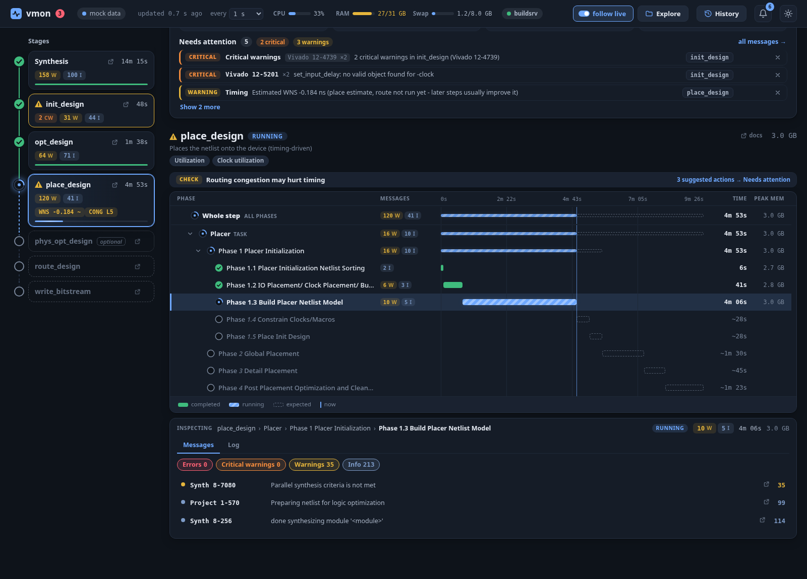
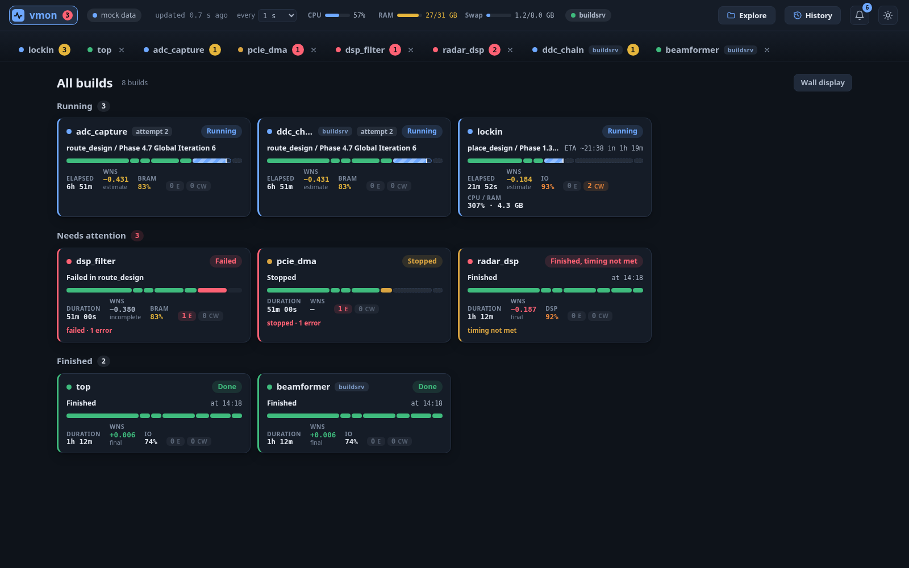

# vmon

[](https://github.com/rodolfocarobene/vivado_monitor/actions/workflows/ci.yml)

Live web monitor for Xilinx Vivado builds: see which step and phase is running, what is still to come, timing, utilization and the warnings that matter, without opening a log file.


## Quick start

1. **Install.** Pick one:
   - Download the prebuilt executable for your system from the [Releases page](https://github.com/rodolfocarobene/vivado_monitor/releases): `vmon-<version>-linux-x86_64` or `vmon-<version>-windows-x86_64.exe`. It bundles its own Python, so nothing else is needed. On Linux, make it executable with `chmod +x`. Maintainers: see [releasing](docs/releasing.md).
   - Or install from a clone (Python 3.11 or newer):

     ```sh
     git clone https://github.com/rodolfocarobene/vivado_monitor.git vivado-monitor
     cd vivado-monitor
     python -m venv .venv
     .venv/bin/pip install -e .      # provides the `vmon` command
     ```

     On Windows (PowerShell):

     ```powershell
     py -m venv .venv
     .venv\Scripts\pip install -e .
     .venv\Scripts\vmon            # or: py -m vmon
     ```

   - Or run without installing: `python -m vmon` from the clone.
2. **Run it.** `vmon` watches every running Vivado build. To also watch a finished run, give it a path: `vmon /path/to/proj.runs`.
3. **Open** http://localhost:8765. The browser opens by itself unless you pass `--no-browser`.

That is all. Start vmon before or after your build. Check the installed version with `vmon --version`. All options (`--port`, `--config`, `--remote`, `--tui`, ...) are in the [user guide](docs/guide.md#command-line).

## What you will see

**Is my build OK, and when will it finish?** The overview hero gives a one-line verdict, a progress strip and four tiles: timing (WNS), utilization, elapsed time and messages. Timing that is only an estimate is never shown red. See [reading the hero](docs/guide.md#how-do-i-read-the-hero-and-needs-attention).

**Which phase is slow, or failing?** Pick a stage and the phase timeline shows every task and phase with a time bar. The inspector below it holds the messages, log, reports and timing paths of the selected row. See [the timeline](docs/guide.md#how-do-i-use-the-phase-timeline-and-inspector).



**What is going on across all my builds?** Click the logo for one card per build, grouped Running, Needs attention and Finished. See [watching builds](docs/guide.md#how-do-i-watch-a-running-build).



**What should I fix first?** The Needs attention list merges alerts, top messages and suggested actions, worst first. A *Fix* fold-out shows the evidence and commands you can copy.


**Which warnings matter?** Messages are scored by severity, rarity and novelty since the last build. Star or mute any message. See [triage](docs/guide.md#how-do-i-triage-messages).


**Is the design too congested?** The inspector shows placer and router congestion levels per direction, with an alert from level 5.


**How did this build do compared with earlier ones?** The history page lists every finished build, with trend charts for WNS, duration and utilization. See [history](docs/guide.md#how-do-i-use-history-and-trends).


**What changed between two builds?** Timing and utilization deltas, step durations and new or removed warnings. See [comparing](docs/guide.md#how-do-i-compare-two-builds-or-a-build-against-the-live-one).


**Light theme, and a phone.** Both themes are supported. On a narrow screen the UI turns into one screen per level. See [phone](docs/guide.md#how-do-i-use-it-on-a-phone).

| Light theme, finished build | Phone |
|---|---|
|  |  |

## What it does

- **Watch a build**: auto-discovers running Vivado processes, one tab per firmware, a stage rail with a phase timeline, ETA with a confidence band, and timing marked "not final" until it is. [Guide](docs/guide.md#how-do-i-watch-a-running-build)
- **Watch a build**: CPU/RAM/swap meters, build info, a live event log, and a terminal view (`vmon status`, `vmon --tui`). [Guide](docs/guide.md#how-do-i-check-a-build-from-the-terminal)
- **Find problems**: the Needs attention list with rule-based suggested actions. [Guide](docs/guide.md#how-do-i-read-the-hero-and-needs-attention)
- **Find problems**: worst timing paths, per-clock history, router convergence and congestion. [Guide](docs/guide.md#how-do-i-use-the-phase-timeline-and-inspector)
- **Find problems**: message triage with star and mute rules you can export and import. [Guide](docs/guide.md#how-do-i-triage-messages)
- **Compare and history**: every finished build with trends, comparison of two builds or of the live build, Markdown and HTML summaries. [Guide](docs/guide.md#how-do-i-use-history-and-trends)
- **Get notified**: browser alerts, plus desktop, ntfy, Slack, Matrix or webhook messages with no browser open. [Guide](docs/guide.md#how-do-i-get-notified)
- **Remote machines**: watch a build server through an SSH tunnel, or several machines in one UI. [Guide](docs/guide.md#how-do-i-watch-builds-on-another-machine)
- **Other flows**: non-project Tcl builds and Vitis HLS. [Guide](docs/guide.md#how-do-i-monitor-non-project-tcl-builds-and-vitis-hls)
- **Anywhere**: keyboard shortcuts, a phone layout and a wall display. [Guide](docs/guide.md#keyboard-shortcuts)
- No AI: pure log parsing. Read-only. Python standard library only.

> [!IMPORTANT]
> **Testing is limited.** vmon has been used and checked on one Linux machine, with Vivado 2023.2 on UltraScale+ RFSoC, plus the automated tests and the mock data in this repository. Other Vivado versions, device families and flows have not been tested and may need catalog entries (see [docs/catalog.md](docs/catalog.md)).
>
> **Vitis HLS** was verified on one 2023.2 `csynth_design` + `export_design` run (Vivado IP flow target). The `csim_design` and `cosim_design` steps are written from the documented log format, and **`v++` (Vitis kernel compile and link) is unverified**: Vitis is not installed on the development machine, so vmon only maps a `v++` process to the build it starts (its Vivado `prj.runs` project, or its Vitis HLS run) and reads no `v++` log.
>
> **Windows support has not been tested with a real Vivado build.** It runs only in CI (unit tests and a smoke test on GitHub's `windows-latest`, without Vivado). Process discovery, log and path handling, the folder explorer and desktop notifications on Windows are implemented but unverified in practice. Reports from Windows users are welcome.

> [!NOTE]
> **About this code.** All the code in this repository was written by Claude (Anthropic's AI model). A human checked it only functionally, by using it and reviewing its behaviour, not by reviewing the code line by line.

## Documentation

- [User guide](docs/guide.md): requirements, command line, how to do each task, keyboard shortcuts, troubleshooting.
- [Configuration](docs/configuration.md): everything you can change in `flows.toml`, and where vmon keeps its files. All Vivado-specific knowledge is data, not code.
- [Phase catalog](docs/catalog.md): steps, phases and tasks per Vivado version.
- [Architecture](docs/architecture.md): modules, data flow, JSON API, development and CI. The architecture contract is in [SPEC.md](SPEC.md).

## Safety

vmon is read-only on your build directories and never signals or kills processes. It binds to `127.0.0.1` by default. With remotes it makes HTTP requests to the configured URLs only (no redirects, no proxies). It writes only to its cache and message-rules file (`~/.cache/vmon/` and `~/.config/vmon/message_rules.json`; on Windows `%LOCALAPPDATA%\vmon\` and `%APPDATA%\vmon\message_rules.json`). On Windows it reads other processes' command line and working directory with query/read access only.

## License

MIT, see [LICENSE](LICENSE). Copyright (c) 2026 Rodolfo Carobene.
